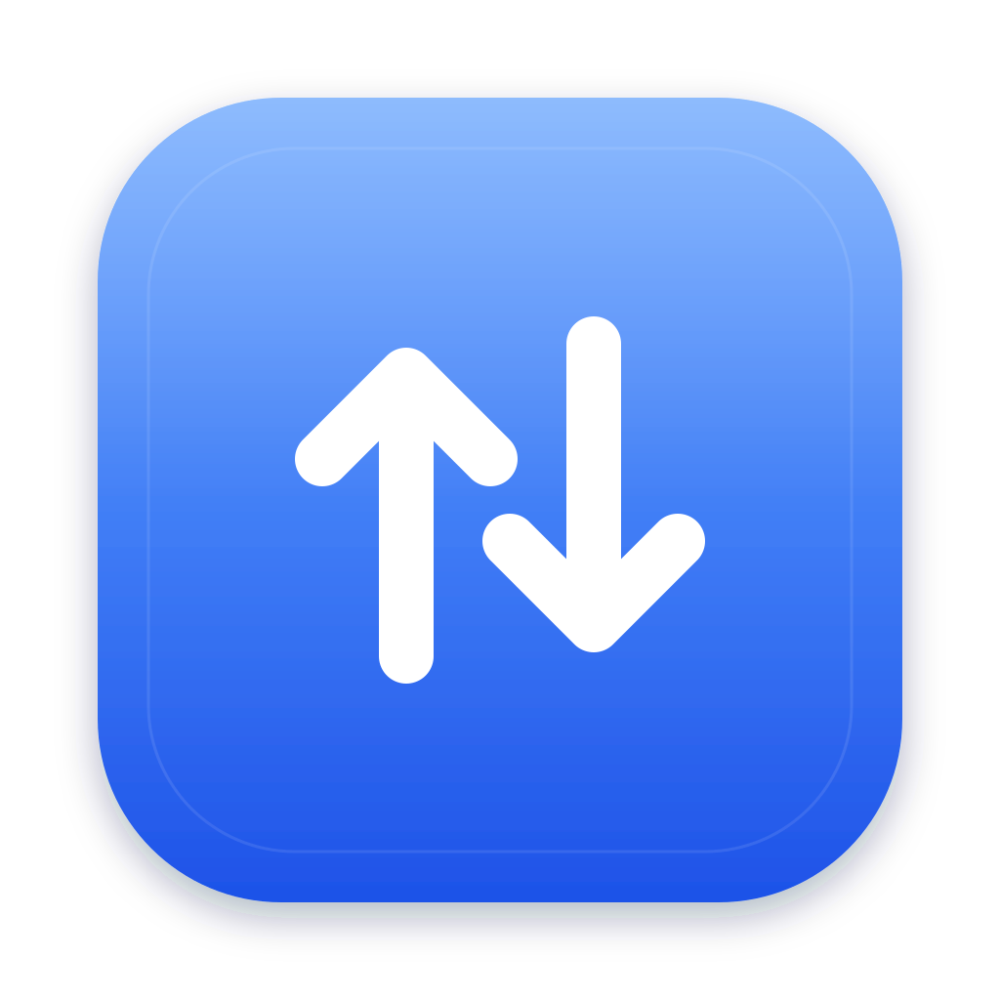
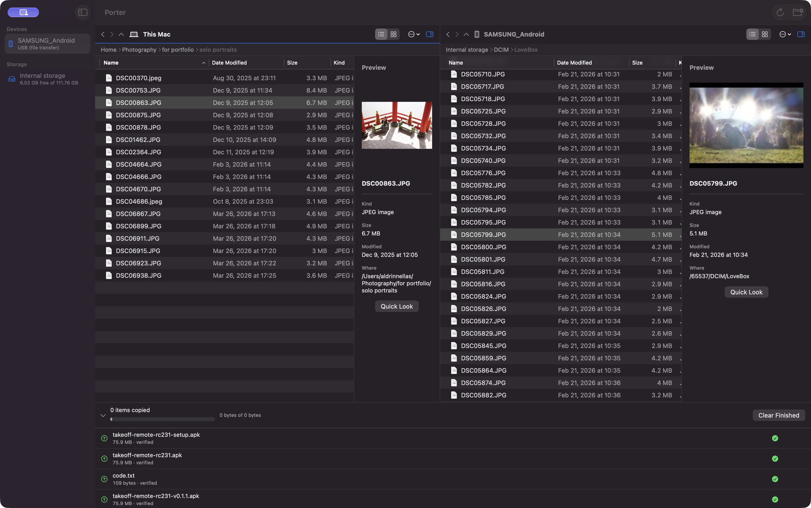
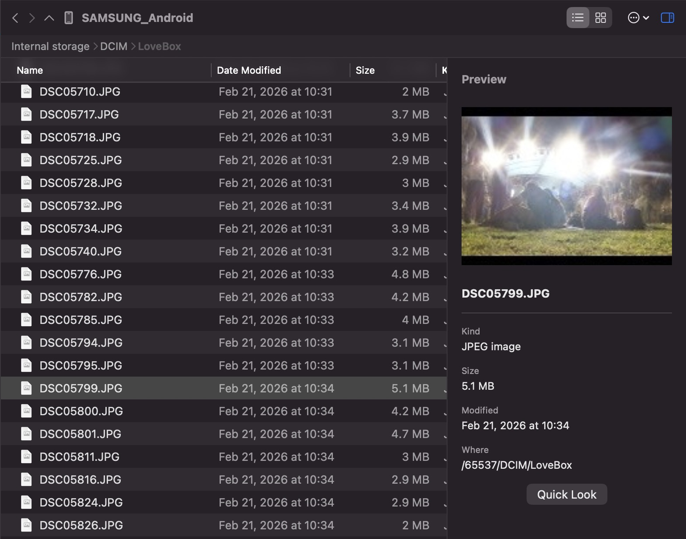

# Porter

### Your Android files, on your Mac.

Browse, preview, and copy files in both directions over USB. A free, native macOS app with optional USB debugging.

**macOS 14+ · Apple silicon & Intel · Free & open source**

[Releases](https://github.com/Ajtn05/Porter/releases) ·
[Get started](#get-started) ·
[User guide](Docs/user-guide.md)

Your Mac on the left. Your Android on the right. Both in one window.

## A familiar place for your files

Bring photos and videos onto your Mac, send documents to your phone, or move
a whole folder in one go. Open the source and destination side by side, then
drag files across or use **⌘C** and **⌘V**. Files copied in Finder can be pasted
straight into Porter's Android pane.

| Browse your way | Know what you're copying | Keep track of each copy |
| --- | --- | --- |
| Switch each pane between list and icon views. Sort by name, date, size, or kind, and use Back and Forward to revisit folders. | Preview a selected file and its details, or open it in Quick Look with Space. Image thumbnails help you find the right photo. | Follow transfers in the queue. Resolve filename conflicts before copying, with free-space and file-size checks where the phone supports them. |

Create folders, rename files, and organize storage on either side. Each pane
remembers its view, sorting, column widths, and preview preferences.

## See more before you copy

The preview sidebar and Quick Look work with files on both devices. Each pane
has its own view controls, so you can browse one as a list and the other as
icons. On MTP connections, Porter prefers thumbnails supplied by the phone.

## One cable. Two ways to connect.

**File Transfer mode works without USB debugging.** Unlock the phone and choose
File Transfer in Android's USB options. Porter uses MTP to browse and copy.

**Enable USB debugging for resume and verification.** Authorize the Mac on your
phone and Porter prefers ADB automatically. ADB transfers can resume after an
interruption and compare SHA-256 checksums with the device. Release builds
include ADB.

| Capability | File Transfer (MTP) | USB debugging (ADB) |
| --- | --- | --- |
| Browse and copy in both directions | Yes | Yes |
| Resume an interrupted copy | Restarts from the beginning | Supported |
| Verify against a device-side checksum | Unavailable; copies are marked not verified | Supported |
| Preserve modification dates | Best effort | Supported |

Files use a temporary name while copying; the final name appears when the
copy is complete. Read more about [connection and transfer behavior](Docs/user-guide.md#file-transfer-mode-mtp).

## Get started

1. **Open Porter.** Requires macOS 14 or later.
2. **Connect and unlock your Android.** Use a USB cable that carries data, then
   select **File Transfer** on the phone. Start Porter before plugging it in.
3. **Choose your folders and copy.** Select the phone's storage in the sidebar,
   open a folder in each pane, and drag or copy and paste between them.

For a camera roll or photo folder, use **Import Photos** to scan, select photos
and videos, and review the copy before it starts. [Photo import →](Docs/user-guide.md#import-photos-and-videos)

**Release status:** v1.2.0 is being prepared. The universal build includes ADB;
public distribution signing and notarization remain pending. Check the
[release notes](Docs/releases/v1.2.0.md) for installation details and known limits,
or [build from source](Docs/development.md#building-and-checks).

## A few things to know

- **Phone not showing up?** Unlock it, check the cable, and select File Transfer.
  If another app or macOS claimed its MTP connection first, reconnect with
  Porter already running. [Connection help →](Docs/user-guide.md#file-transfer-mode-mtp)
- **Can I use Finder?** Finder access is an experimental, read-only extension
  that still needs signed, real-device validation. Use Porter's browser for
  transfers.
- **Will it work with my phone?** Early testing used a Galaxy S22 on Android 16.
  Wider device compatibility and sustained-load testing are still in progress.
- **Does it need an account or cloud service?** No. Porter transfers over USB
  without accounts, a cloud relay, or telemetry.

## Open source, built for macOS

Porter uses SwiftUI and a shared Swift transfer engine. It is licensed under
[GPL-3.0](LICENSE). Bug reports, device compatibility reports, and contributions
are welcome on [GitHub](https://github.com/Ajtn05/Porter/issues).

[Development & builds](Docs/development.md) ·
[Architecture](Docs/architecture.md) ·
[Implementation status](Docs/status.md) ·
[Testing notes](Docs/testing-notes.md)
